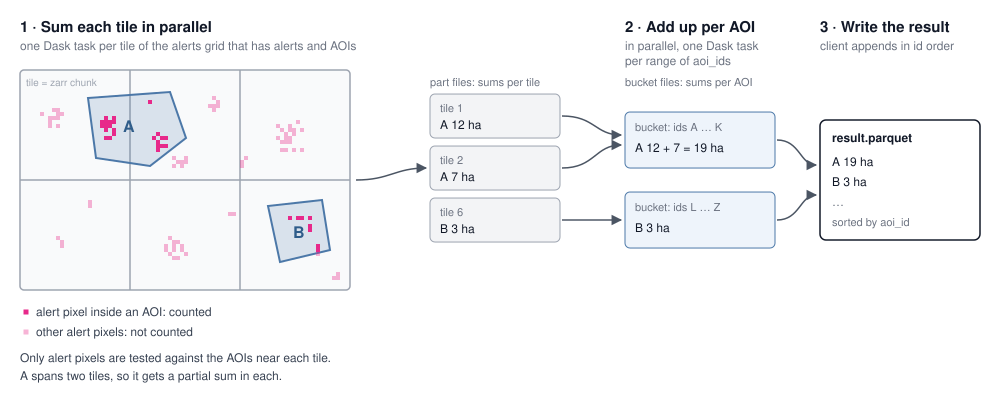

## Vector zonal statistics (points in polygons)

Zonal statistics of vector areas of interest (AOIs) over sparse rasters such as
integrated alerts. Instead of rasterizing AOI polygons onto the grid (the flox
approach), the pipeline takes only the *candidate pixels* — the pixels that can
contribute to a result, e.g. alert pixels — and tests their centers against the
AOI polygons. The code is in
`pipelines/zonal_stats/pixels_in_polygons.py` (the engine) and
`pipelines/zonal_stats/aoi_sources.py` (where AOIs come from); integrated
alerts is the first dataset (`pipelines/integrated_alerts/vector_zonal_stats.py`).

### How a run works

1. **Plan (client).** Read every AOI's bounding box from the AOI source and
   list the dataset's tiles (one per zarr chunk with data). Only tiles that an
   AOI's bounding box touches get a task.
2. **Sum each tile in parallel (one Dask task per tile).** A task:
   - reads the polygons of the AOIs near its tile and clips them to it;
   - reads the tile's candidate pixels, with the dataset's layers at each pixel
     as columns. For integrated alerts, candidates are pixels with an alert
     from 2023-01-01 at low, high or highest confidence, and the layers are the
     alert date and confidence, the natural lands class and the pixel area.
     This is where the method gains on sparse data: *candidates are a small
     fraction of a tile's pixels, and every later step works only on them*;
   - keeps the pixels whose centers each polygon contains (one shapely STRtree
     `contains` query — the API's pixel-center rule) and sums by AOI and group;
   - writes these partial sums to a part file, sorted by `aoi_id`.

   Identical polygons listed under several ids are computed once.
3. **Add up per AOI in parallel (one Dask task per bucket).** An AOI that spans
   several tiles has partial sums in each. The results don't fit in client
   memory, so the client splits the sorted `aoi_id`s into buckets of
   consecutive ids (`AOIS_PER_BUCKET`; a "bucket" here is an id range, not an
   S3 bucket). Each bucket task reads its id range from every part file, sums
   each AOI across tiles, applies the dataset's `finish` step (labels, column
   order) and writes a bucket file.
4. **Write the result (client).** The client appends the bucket files, one at a
   time in bucket order, into a single parquet sorted by `aoi_id`, then deletes
   the part and bucket files.

### When this method fits

The work per tile scales with the number of candidate pixels, not with the size
of the grid: pixels that can't contribute are dropped before any polygon test
(step 2), and tiles without data get no task at all (step 1).
That is what makes it cheap on sparse rasters such as alerts, where candidates
are a small fraction of each tile. On a dense raster, where most pixels count
(e.g. land cover everywhere), every pixel becomes a point to test and
rasterizing the AOIs (flox) is likely the better fit.

### Why buckets combine quickly

Each bucket task reads only the data in its id range, with no data moved
between workers:

- **Layout.** Each part file covers one small tile, so it holds only nearby
  AOIs, and its rows are sorted by `aoi_id`: every file has a narrow id range.
- **Parquet statistics.** A reader with the filter
  `first_id <= aoi_id <= last_id` reads each file's footer (min/max `aoi_id`
  per row group) and skips files and row groups that can't match without
  downloading them. Matching row groups are read and filtered to the range.
- **Range partitioning.** Buckets are consecutive id ranges of the same sort
  order, so each maps onto a narrow set of files, and appending them in order
  gives a sorted result without a global sort.

A Dask dataframe groupby gives the same result but has to move every row across
the network twice (the groupby shuffle, then the sort by `aoi_id`), since it
can't know the parts are already sorted. See "Alternatives considered".

### AOI sources

An `AOISource` returns every AOI's bounding box (`read_bounds`), the polygons
near a tile (`read`) and where they came from (`provenance`, written into the
result's metadata).

- `IcebergSource` reads the custom AOI table (`custom.custom_aois`) that the
  API writes. Users can change AOIs during a run, so the source is pinned to
  the table's snapshot when the run starts (`custom_aoi_source()` returns it
  pinned); every read uses that snapshot, an unpinned source refuses to read,
  and the snapshot id is recorded as `aoi_snapshot_id` in the result.

### Adding a dataset

The engine is dataset-agnostic. A dataset adapter passes `compute_zonal_stats`:

- `tiles`: the dataset's tiles with their bounds;
- `read_pixels(ys, xs)`: reads a tile's candidate pixels and the dataset's
  layers (zarrs) at those pixels, returning one row per pixel with its
  pixel-center `x`, `y` and a column per layer;
- `by`: the layer columns results are grouped by (e.g. `natural_lands_class`,
  `alert_date`, `confidence`), and `sum_column`: the layer column summed (e.g.
  `area_ha`);
- `finish(sums)`: the last step on each bucket's per-AOI sums (labels, column
  order), and `schema` for the result.

Sums must be decomposable — partial sums from tiles are added in the combine
step — so the engine supports sums (and counts, min/max, or means via sum and
count in `finish`), not medians or percentiles.

### Results

On integrated alerts version `v20261025` with GADM (all units), compared with
the rasterized flox results for the same version:

- the results match exactly for every unit both compute (236 of 241 countries,
  3,577 of 3,592 regions and 46,543 of 46,575 subregions exactly; the rest
  differ by id mismatches between the rasterized GADM and the AOI table, or by
  under a hectare at boundary pixels);
- they also cover disputed territories and units numbered 0, which the
  rasterized layers leave out;
- a global run cost about $10 against $42 for the flox pipeline (Coiled's
  estimates, on the same cluster configuration).

### Alternatives considered

- **Rasterizing the AOIs (flox).** Reduces the whole grid by zone; about 4x the
  cost on integrated alerts, and limited to zones that rasterize cleanly.
- **Dask dataframe groupby for the combine step.** About 50 fewer lines of
  code and the same output (validated on the global GADM run: identical rows,
  totals within 1e-6 ha). But its two shuffles made the combine take roughly
  40 minutes instead of a few (an estimated $13–14 per run against $10), it
  needed tuning (explicit `split_out`, partition sizes) to finish at all, and
  it relied on a Dask upgrade. Buckets were kept.
